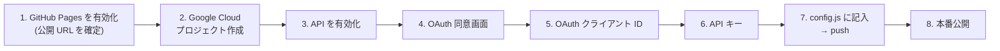

# セットアップ & GitHub Pages 公開ガイド

このガイドでは、Drive Box を **GitHub Pages で公開し、誰でも自分の Google Drive で使える状態にする** までの手順を解説します。

全体の流れ:



> 所要時間の目安: 20〜30 分

---

## 1. GitHub Pages を有効化する（先に URL を確定させる）

OAuth の設定に「公開 URL」が必要なので、まず Pages を有効にします。

1. GitHub で `kon3dayo/gdrive` レポジトリを開く
2. **Settings** → 左メニュー **Pages**
3. **Build and deployment** の **Source** で **Deploy from a branch** を選択
4. **Branch** で `main` / `/ (root)` を選び **Save**
5. 1〜2 分待つと、ページ上部に公開 URL が表示されます

```
https://kon3dayo.github.io/gdrive/
```

> [!NOTE]
> このアプリはビルド不要の静的サイト（HTML / CSS / JS のみ）なので、ブランチをそのまま公開するだけで動きます。`.nojekyll` ファイルは Jekyll の処理をスキップさせるためのものです。

以降、この URL を **公開 URL**、`https://kon3dayo.github.io` を **オリジン**（パスを含まない部分）と呼びます。

---

## 2. Google Cloud プロジェクトを作成する

1. [Google Cloud Console](https://console.cloud.google.com/) を開き、Google アカウントでログイン
2. 画面上部のプロジェクト選択 → **新しいプロジェクト**
3. プロジェクト名（例: `drive-box`）を入力して **作成**
4. 作成したプロジェクトが選択されていることを確認

> 料金はかかりません（Drive API・Picker API は無料で利用できます。請求先アカウントの登録も不要です）。

---

## 3. API を有効化する

**API とサービス → ライブラリ** で次の 2 つを検索し、それぞれ **有効にする** をクリックします。

| API | 用途 |
| --- | --- |
| **Google Drive API** | ファイルの一覧・アップロード・ダウンロードなど |
| **Google Picker API** | Drive の既存ファイルを選択する画面 |

---

## 4. OAuth 同意画面（Google Auth Platform）を設定する

ログイン時に表示される「このアプリに許可しますか？」画面の設定です。

1. 左メニュー **API とサービス → OAuth 同意画面**（または [Google Auth Platform](https://console.cloud.google.com/auth/overview)）を開き **開始** をクリック
2. **アプリ情報**
   - アプリ名: `Drive Box`（任意）
   - ユーザーサポートメール: 自分のメールアドレス
3. **対象（Audience）**: **外部（External）** を選択
   - 「内部」は Google Workspace 組織内限定です。誰でも使えるようにするには「外部」を選びます
4. **連絡先情報**: 自分のメールアドレス
5. 同意して **作成**

### データアクセス（スコープ）

1. **データアクセス** → **スコープを追加または削除**
2. `https://www.googleapis.com/auth/drive.file` を検索してチェック → **更新** → **保存**

> [!TIP]
> `drive.file` は「このアプリで作成したファイル」と「ユーザーが Picker で選んだファイル」にだけアクセスできる **非機密スコープ** です。Drive 全体にアクセスする `drive` スコープと違い、一般公開しても **Google の審査（セキュリティ評価）が不要** です。

---

## 5. OAuth クライアント ID を作成する

1. **Google Auth Platform → クライアント**（または **API とサービス → 認証情報 → 認証情報を作成 → OAuth クライアント ID**）
2. **アプリケーションの種類**: **ウェブ アプリケーション**
3. **名前**: `Drive Box Web`（任意）
4. **承認済みの JavaScript 生成元** に次を追加:

   ```
   https://kon3dayo.github.io
   ```

   ローカルでも動作確認したい場合は追加で:

   ```
   http://localhost:8000
   ```

5. **承認済みのリダイレクト URI** は **空のまま** で OK（ポップアップ方式のため不要）
6. **作成** → 表示された **クライアント ID**（`xxxx.apps.googleusercontent.com`）をコピー

> [!IMPORTANT]
> 「生成元」にはパス（`/gdrive/`）や末尾のスラッシュを **付けません**。`https://kon3dayo.github.io` だけを入力してください。設定の反映には数分〜最大数時間かかることがあります。

---

## 6. API キーを作成する（Picker 用）

1. **API とサービス → 認証情報 → 認証情報を作成 → API キー**
2. 作成されたキーの **キーを編集**（または「API キーを制限」）を開く
3. **アプリケーションの制限**: **ウェブサイト** を選び、次を追加

   ```
   https://kon3dayo.github.io/*
   http://localhost:8000/*
   ```

4. **API の制限**: **キーを制限** → **Google Picker API** のみを選択
5. **保存** → キーをコピー

> [!WARNING]
> API キーはブラウザに配信されるため誰でも見られます。**必ず上記の制限をかけてください**。制限があれば、他サイトから流用されることはありません。

### プロジェクト番号を確認する

Picker でファイルへのアクセス権をアプリに付与するために、**プロジェクト番号**（数字）が必要です。

- Cloud Console 右上の ⋮ → **プロジェクトの設定**、またはダッシュボードの **プロジェクト情報** カードで確認できます（「プロジェクト ID」ではなく **「プロジェクト番号」** です）

---

## 7. `js/config.js` に設定値を記入して push する

[`js/config.js`](../js/config.js) を開き、3 つの値を書き換えます。

```js
export const CONFIG = {
  CLIENT_ID: '1234567890-abcdefg.apps.googleusercontent.com',
  API_KEY: 'AIzaSy....',
  APP_ID: '1234567890',
};
```

コミットして push します。

```bash
git add js/config.js
git commit -m "Configure Google API credentials"
git push origin main
```

1〜2 分で GitHub Pages に反映されます（**Actions** タブの `pages build and deployment` が緑になれば完了）。公開 URL を開いて **Google でログイン** を試してください。

> [!NOTE]
> クライアント ID と API キーを公開レポジトリにコミットするのは、ブラウザだけで動くアプリでは一般的な方法です。クライアント ID は「承認済みの生成元」で、API キーは「リファラー制限」で保護されます。**クライアント シークレットは絶対にコミットしないでください**（このアプリでは使用しません）。

---

## 8. 本番公開する（誰でも使えるようにする）

作成直後のアプリは **テスト** 状態で、**テストユーザーに登録した人しかログインできません**。

### テスト中に使う場合

**Google Auth Platform → 対象（Audience）→ テストユーザー → ユーザーを追加** で、使う人の Gmail アドレスを登録します（最大 100 人）。

### 誰でも使えるようにする場合

1. **Google Auth Platform → 対象（Audience）**
2. 公開ステータスの **アプリを公開** → **確認**
3. ステータスが **本番環境** になれば、Google アカウントを持つ誰でもログインできます

> [!TIP]
> `drive.file` などの非機密スコープのみであれば、ブランド（ロゴ等）の確認を申請しない限り審査なしで公開できます。審査前は同意画面に「Google はこのアプリを確認していません」と表示される場合がありますが、「詳細」→「（安全ではないページ）に移動」で続行できます。気になる場合は **ブランディング** からホームページ URL・プライバシーポリシー URL を登録して確認を申請してください。

---

## ローカルで動作確認する

ES Modules を使っているため、`file://` で直接開くのではなくローカルサーバーを立ててください。

```bash
# Python がある場合
python3 -m http.server 8000

# Node.js がある場合
npx serve -l 8000
```

ブラウザで <http://localhost:8000> を開きます（手順 5・6 で localhost を許可しておく必要があります）。

---

## よくあるトラブル

| 症状 | 原因と対処 |
| --- | --- |
| `Error 400: redirect_uri_mismatch` / `origin_mismatch` | 手順 5 の「承認済みの JavaScript 生成元」が URL と一致していません。`https://kon3dayo.github.io`（パスなし・末尾スラッシュなし）になっているか確認。反映に数分かかることもあります |
| `Error 403: access_denied`（このアプリはテスト中です） | 手順 8 でテストユーザーに追加するか、アプリを本番公開してください |
| ログインのポップアップが開かない | ブラウザのポップアップブロックを解除してください |
| 「Drive から既存ファイルを追加」でエラー | Picker API の有効化（手順 3）、API キーのリファラー制限（手順 6）、`APP_ID` がプロジェクト **番号** になっているかを確認 |
| Drive にあるはずのファイルが表示されない | `drive.file` スコープの仕様です。アプリでアップロードしたファイル以外は、「新規 → Drive から既存ファイルを追加」で選択すると表示されるようになります |
| 1 時間ほどでログアウトされる | アクセストークンの有効期限（約 1 時間）です。サーバーを持たない構成のため、再度ログインしてください |
| 変更が反映されない | ブラウザのキャッシュが原因のことがあります。スーパーリロード（Ctrl/Cmd + Shift + R）を試してください |

---

## 独自ドメインで公開する場合（任意）

1. GitHub の **Settings → Pages → Custom domain** にドメインを入力
2. DNS に CNAME レコード（`kon3dayo.github.io` 向け）を設定
3. **Enforce HTTPS** を有効化
4. Google Cloud の **承認済みの JavaScript 生成元** と **API キーのリファラー制限** に新しいドメインを追加
